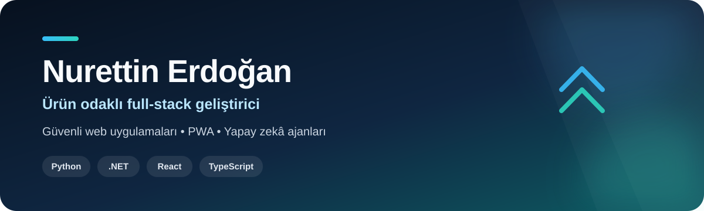

  

Canlıya alınmış, testleri ve CI süreçleri olan, ürün odaklı uygulamalar geliştiriyorum. Odak alanlarım **.NET backend**, **yapay zekâ uygulamaları** (RAG, LLM ajanları) ve **uygulama güvenliği**.

> **English:** Computer engineering student in Istanbul, building production-minded .NET, AI/RAG and application security projects. Every featured project is live, tested in CI, and has an English summary in its README.

## Öne çıkan projeler

<table>
  <tr>
    <td width="50%" valign="top">
      
      <h3>SmartDocs AI</h3>
      
PDF üzerinde soru-cevap ve kaynak inceleme. Gemini destekli canlı sürüm, Ollama ile yerel RAG kurulumu.

      
<strong>Stack:</strong> ASP.NET Core · React/TypeScript · PostgreSQL · Qdrant · Ollama

      
<a href="https://smartdocs-ai-henna.vercel.app/">Uygulamayı aç ↗</a> · <a href="https://github.com/Nurettin-Erdogan/smartdocs-ai">Kaynak kod</a>

    </td>
    <td width="50%" valign="top">
      
      <h3>Servis Defteri</h3>
      
Servis taleplerini, randevuları, iş akışını ve ödemeleri web, mobil ve API üzerinde bir araya getiren servis yönetimi uygulaması.

      
<strong>Stack:</strong> React/Vite · Expo · Node.js/Express · Prisma · PostgreSQL

      
<a href="https://islik-cloud.vercel.app/">Uygulamayı aç ↗</a> · <a href="https://github.com/Nurettin-Erdogan/servis-defteri">Kaynak kod</a>

    </td>
  </tr>
  <tr>
    <td width="50%" valign="top">
      
      <h3>Kalkan</h3>
      
<strong>Kullanıcılar için dolandırıcılık analizi.</strong> Şüpheli mesaj, bağlantı ve ekran görüntülerini tamamen tarayıcıda, açıklanabilir kurallarla inceler; veri cihazdan çıkmaz.

      
<strong>Stack:</strong> React · TypeScript · Tesseract.js · Tailwind CSS

      
<a href="https://nurettin-erdogan.github.io/kalkan/">Uygulamayı aç ↗</a> · <a href="https://github.com/Nurettin-Erdogan/kalkan">Kaynak kod</a>

    </td>
    <td width="50%" valign="top">
      
      <h3>Ajan Kalkanı</h3>
      
<strong>Geliştiriciler için yapay zekâ ajanı güvenlik geçidi.</strong> Ajanın araç çağrılarını çalışmadan önce yetki kurallarıyla denetler (varsayılan-ret); prompt injection senaryolarını korumasız ve korumalı modda yan yana karşılaştırır.

      
<strong>Stack:</strong> Python · FastAPI · SQLite (hash zinciri) · GitHub Actions · CodeQL

      
<a href="https://ajan-kalkani.vercel.app/">Uygulamayı aç ↗</a> · <a href="https://github.com/Nurettin-Erdogan/ajan-kalkani">Kaynak kod</a>

    </td>
  </tr>
</table>

## Projelerimde ortak olanlar

- **Canlıda çalışır.** Her projenin herkese açık bir canlı sürümü var; README'den tek tıkla denenebilir.
- **Her değişiklik CI'dan geçer.** Test, lint ve derleme her PR'da çalışır; Dependabot bağımlılıkları güncel tutar, çoğu projede CodeQL güvenlik taraması var.
- **Ölçerek geliştiririm.** Kalkan'ın kural motoru etiketli bir değerlendirme setinde doğruluk eşiğini geçmeden birleşmez; Ajan Kalkanı'nın CI'ı saldırı başarısı ve yanlış engelleme oranlarına eşik koyar.
- **Sınırları açıkça yazarım.** SmartDocs AI, Kalkan ve Ajan Kalkanı'nın README'lerinde projenin neyi yapmadığı ve hangi koşullarda yanılabileceği ayrı bir bölümde anlatılır.

## Diğer projeler

<table>
  <tr>
    <td width="50%" valign="top">
      
      <h4>Türkiye Hava</h4>
      
Türkiye'nin il ve ilçeleri için hava tahmini. Konum doğrulaması, çevrimdışı son tahmin ve kurulabilir PWA.

      
JavaScript · Open-Meteo · Service Worker · Playwright

      
<a href="https://turkiye-hava-pwa.vercel.app">Uygulamayı aç ↗</a> · <a href="https://github.com/Nurettin-Erdogan/weather-app">Kaynak kod</a>

    </td>
    <td width="50%" valign="top">
      
      <h4>Görev Listesi</h4>
      
Cihazda çalışan görev yöneticisi. Öncelik, son tarih, geri alma, sekmeler arası eşitleme ve çevrimdışı kullanım.

      
JavaScript · PWA · Service Worker · Playwright

      
<a href="https://gorev-listesi-pwa.vercel.app/">Uygulamayı aç ↗</a> · <a href="https://github.com/Nurettin-Erdogan/todo-app">Kaynak kod</a>

    </td>
  </tr>
</table>

## Teknolojiler

**Backend ve veri:** C# · ASP.NET Core · EF Core · Python · FastAPI · Node.js · Express · Prisma · PostgreSQL · SQL Server · SQLite · Qdrant  
**Frontend ve mobil:** React · TypeScript · JavaScript · Vite · Tailwind CSS · Expo (React Native) · PWA  
**Yapay zekâ:** RAG · LLM ajanları · Ollama · Gemini  
**Test ve DevOps:** xUnit · pytest · Vitest · Playwright · Docker · GitHub Actions · CodeQL

## Deneyim ve eğitim

**Darphane ve Damga Matbaası Genel Müdürlüğü** · Bilgi Teknolojileri Stajyeri  
Temmuz–Ağustos 2026

Kurumsal yazılım süreçlerinde yazılım testleri, yetkilendirme akışları ve barkod entegrasyonu testleri üzerinde çalıştım. ASP.NET Core ve SQL Server tabanlı uygulama süreçlerini inceleyerek test, hata ayıklama ve entegrasyon tarafında deneyim kazandım.

**İstanbul Atlas Üniversitesi** · Bilgisayar Mühendisliği  
2023–devam ediyor

## İletişim

[📄 CV](./assets/Nurettin_Erdogan_CV.pdf) · [💼 LinkedIn](https://www.linkedin.com/in/nurettin-e-7b5508289/) · [✉️ E-posta](mailto:enurettin89@gmail.com)
