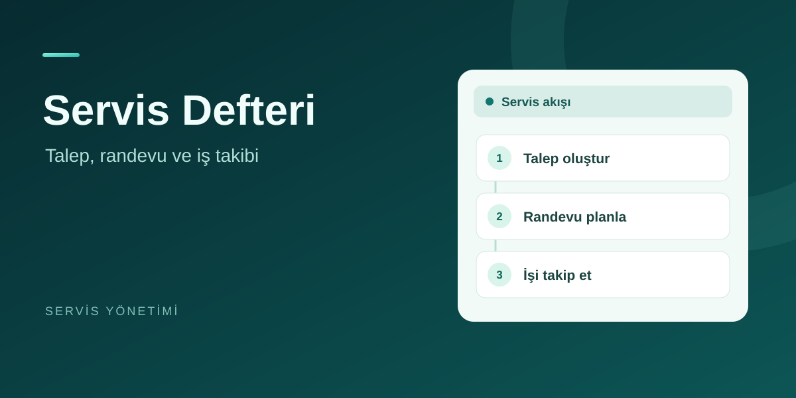

# Nurettin Erdoğan

**Bilgisayar Mühendisliği Öğrencisi · Full-Stack & Backend · AI/RAG**

Canlıya alınmış, test ve CI süreçleri bulunan ürün odaklı uygulamalar geliştiriyorum. Full-stack/backend, AI/RAG ve güvenlik odaklı projeler üzerinde çalışıyorum.

## Öne çıkan projeler

<table>
  <tr>
    <td width="50%" valign="top">
      
      <h3>SmartDocs AI</h3>
      
PDF üzerinde soru-cevap ve kaynak inceleme. Gemini destekli canlı sürüm, Ollama ile yerel RAG kurulumu.

      
<strong>Stack:</strong> ASP.NET Core · React/TypeScript · PostgreSQL · Qdrant · Ollama

      
<a href="https://smartdocs-ai-henna.vercel.app/">Uygulamayı aç ↗</a> · <a href="https://github.com/Nurettin-Erdogan/smartdocs-ai">Kaynak kod</a>

    </td>
    <td width="50%" valign="top">
      
      <h3>Servis Defteri</h3>
      
Servis taleplerini, randevuları, iş akışını ve ödemeleri web, mobil ve API üzerinde bir araya getiren servis yönetimi uygulaması.

      
<strong>Stack:</strong> React/Vite · Expo · Node.js/Express · Prisma · PostgreSQL

      
<a href="https://islik-cloud.vercel.app/">Uygulamayı aç ↗</a> · <a href="https://github.com/Nurettin-Erdogan/servis-defteri">Kaynak kod</a>

    </td>
  </tr>
  <tr>
    <td width="50%" valign="top">
      
      <h3>Kalkan</h3>
      
<strong>Kullanıcılar için dolandırıcılık analizi.</strong> Şüpheli mesaj, bağlantı ve ekran görüntülerini tamamen tarayıcıda, açıklanabilir kurallarla inceler; veri cihazdan çıkmaz.

      
<strong>Stack:</strong> React · TypeScript · Tesseract.js · Tailwind CSS

      
<a href="https://nurettin-erdogan.github.io/kalkan/">Uygulamayı aç ↗</a> · <a href="https://github.com/Nurettin-Erdogan/kalkan">Kaynak kod</a>

    </td>
    <td width="50%" valign="top">
      
      <h3>Ajan Kalkanı</h3>
      
<strong>Geliştiriciler için yapay zekâ ajanı güvenlik geçidi.</strong> Ajanın araç çağrılarını çalışmadan önce yetki kurallarıyla denetler (varsayılan-ret); prompt injection senaryolarını korumasız ve korumalı modda yan yana karşılaştırır.

      
<strong>Stack:</strong> Python · FastAPI · SQLite (hash zinciri) · GitHub Actions · CodeQL

      
<a href="https://ajan-kalkani.vercel.app/">Uygulamayı aç ↗</a> · <a href="https://github.com/Nurettin-Erdogan/ajan-kalkani">Kaynak kod</a>

    </td>
  </tr>
</table>

### Teknolojiler

**Backend & Data:** C# · ASP.NET Core · Node.js · PostgreSQL · SQL Server · Qdrant  
**Frontend & Platform:** React · TypeScript · JavaScript · Docker · GitHub Actions · PWA  
**AI:** RAG · Ollama · Gemini

### Deneyim ve eğitim

**Darphane ve Damga Matbaası Genel Müdürlüğü** · Bilgi Teknolojileri Stajyeri  
Temmuz–Ağustos 2026

Kurumsal yazılım süreçlerinde yazılım testleri, yetkilendirme akışları ve barkod entegrasyonu testleri üzerinde çalıştım. ASP.NET Core ve SQL Server tabanlı uygulama süreçlerini inceleyerek test, hata ayıklama ve entegrasyon tarafında deneyim kazandım.

**İstanbul Atlas Üniversitesi** · Bilgisayar Mühendisliği  
2023–devam ediyor

### İletişim

[📄 CV](./assets/Nurettin_Erdogan_CV.pdf) · [💼 LinkedIn](https://www.linkedin.com/in/nurettin-e-7b5508289/) · [✉️ E-posta](mailto:enurettin89@gmail.com)
